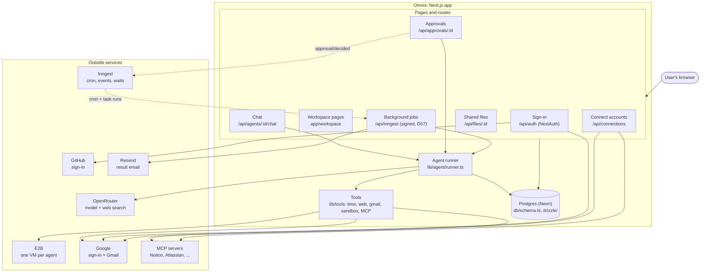
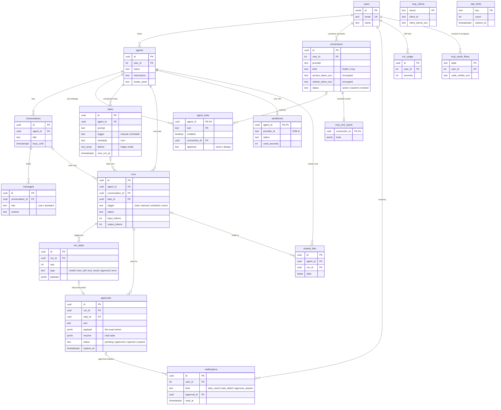
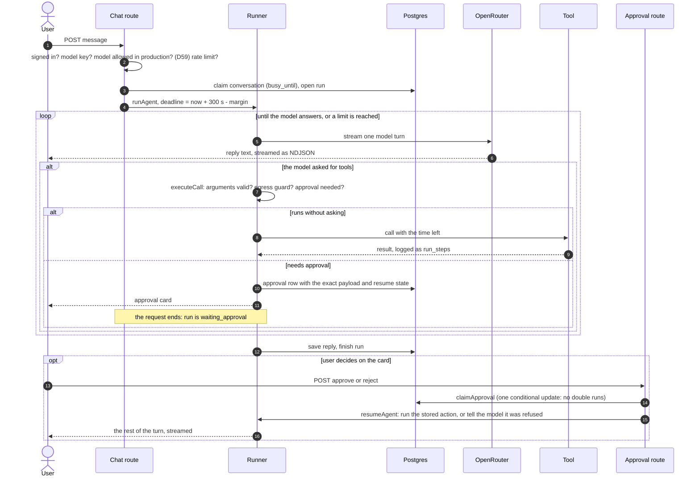
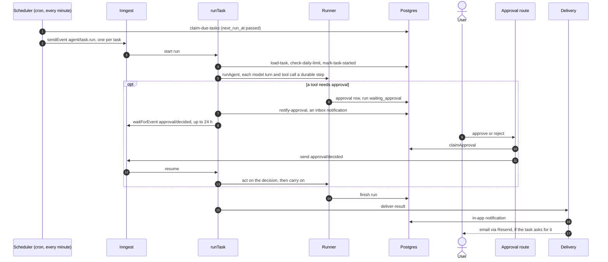
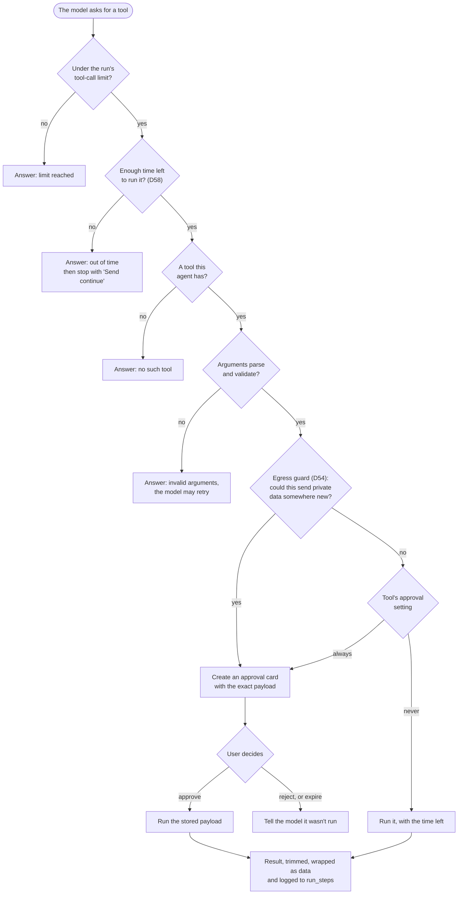
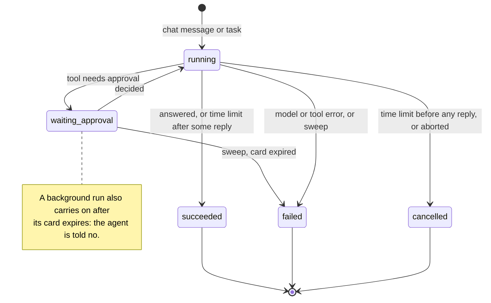
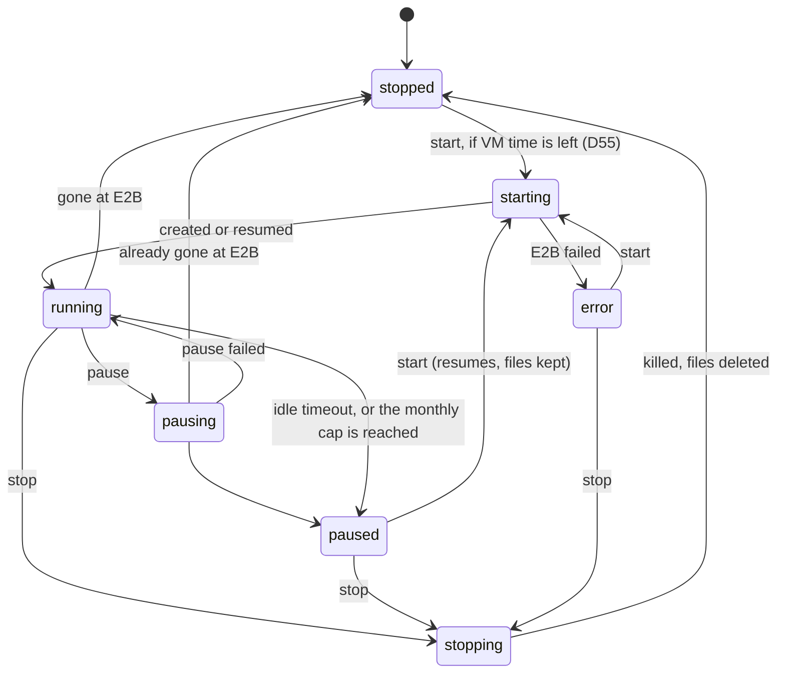
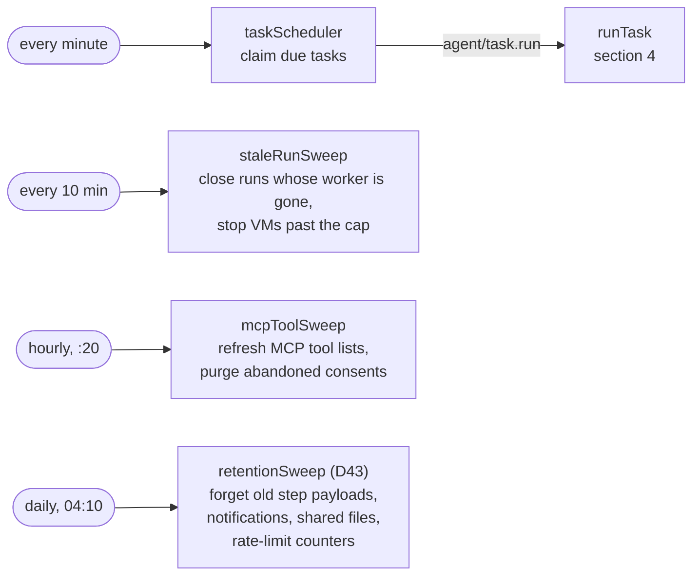
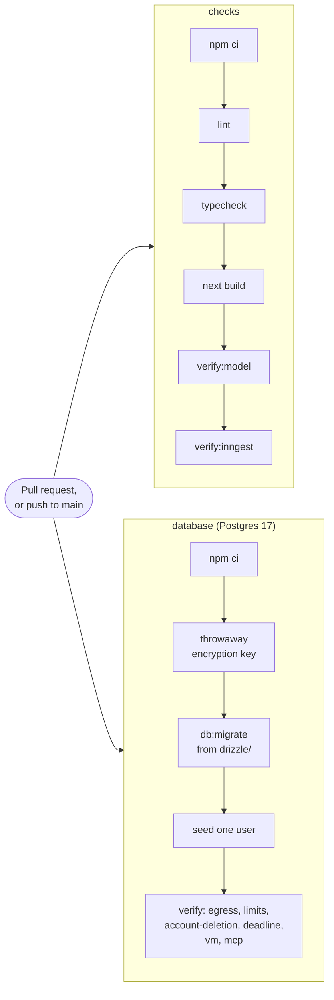

# 11. Diagrams

The code as it stands on `production-guards` (after D59), drawn in Mermaid. GitHub and
VS Code render these in place. Each diagram covers one idea; the numbered docs hold the
detail and the reasons.

1. [System overview](#1-system-overview): what talks to what
2. [Data model](#2-data-model): every table and how they connect
3. [A chat turn](#3-a-chat-turn): one message, including an approval
4. [A scheduled task](#4-a-scheduled-task): a background run, start to delivery
5. [One tool call](#5-one-tool-call): what the runner decides before a tool runs
6. [Run status](#6-run-status)
7. [VM lifecycle](#7-vm-lifecycle)
8. [Background sweeps](#8-background-sweeps)
9. [CI](#9-ci)

## 1. System overview

The runner is shared (D9): a chat message and a scheduled task go through the same loop,
limits and logging. Only how they wait for an approval differs (sections 3 and 4).

## 2. Data model

Every table belongs to a user, and deleting the user cascades to all of it (D56).
`mcp_clients` and `rate_limits` have no user link: clients are shared per issuer, and
rate limits are counters keyed by a string.

## 3. A chat turn

One request is one turn, with a deadline just inside the route's 300 s limit (D58). If the
agent asks for approval, the request ends there; the decision arrives as a **second**
request, which runs the stored action and lets the agent carry on (D35).

When time runs short the runner skips tools it can no longer finish, keeps 40 s for a last
model turn, and ends with "Send continue" rather than being cut off (D58).

## 4. A scheduled task

Background runs live in Inngest, so waiting for an approval costs nothing: the run sleeps
on `step.waitForEvent` for up to 24 hours and carries on in the same run (D41). Each step
is its own request, so no request deadline applies.

## 5. One tool call

`executeCall` in `lib/agent/runner.ts`. Nothing the model says is trusted: arguments are
checked, and an approved action runs the stored payload, not a fresh one.

## 6. Run status

`lib/agent/runs.ts` and the end of `drive` in the runner. Every run is created as
`running`; `queued` is in the schema but nothing sets it yet.

## 7. VM lifecycle

`lib/sandbox`. Every change is a claim: one conditional update from the allowed states,
so two clicks make one VM. The in-between states (`starting`, `pausing`, `stopping`) are
held only while E2B is called.

## 8. Background sweeps

Every scheduled function in `lib/inngest`. `runTask` is the only one started by an event;
the rest run on a timer.

## 9. CI

`.github/workflows/ci.yml` (D59): two jobs in parallel on every pull request and every push
to `main`. No secrets; nothing calls a real model, VM or account.

